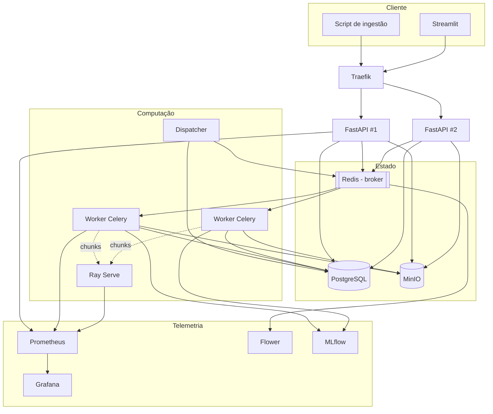

# Pipeline Distribuído para Análise de Imagem de High-Content Screening

**Especificação técnica — v4**
Projeto de aprendizagem. Não se destina a produção clínica.

---

## Alterações face à v3

| # | Alteração | Motivo |
|---|---|---|
| 1 | **Dois carris de dados** (§2, §8) | O Objetivo B e o Objetivo F usavam regimes de imagem opostos a fingir que eram o mesmo problema |
| 2 | **`work_units` + `unit_runs` + subtipo por tabela** (§6) | Estado por `(unidade, run)`. Reprocessar deixa de sobrescrever o run anterior |
| 3 | **`cell_metrics` sai do Postgres para Parquet** (§6.3) | 13,2 M linhas/run com JSONB não cabe nesta máquina |
| 4 | **Dois readouts, não um** (§9.2) | Um composto que mata e um que deforma sem matar são hits diferentes |
| 5 | **`control_type` por par composto-concentração** (§9.1) | Marcar por composto contamina os controlos com a própria curva de dose |
| 6 | **Efeito de lote como resultado da Fase 6** (§9.5) | Resultado defensável e quase gratuito: o taxol 0,3 µM está nas 55 placas |
| 7 | **Critérios F reescritos** (§19) | Um critério tem de testar o sistema, não a sorte do dataset |
| 8 | **MoA desce para a Fase 7** (§20) | Ambição científica concentrada num único resultado por sprint |
| 9 | **CAMELYON16 fora de âmbito, com motivo** (§2.2) | Prevenir scope creep na semana oito |
| 10 | **Regra de decisão do conjunto de placas** (§21.2) | "Decidido pelo spike" sem regra transforma-se em decidido por inércia |
| 11 | Canais lidos do CSV, sem mapeamento (§7.1) | Hardcodear a convenção certa continua a ser hardcodear |
| 12 | Correções de esquema: `content_sha256`, `lockfile_hash`, `moa_predictions`, base `mlflow`, `core_regions` | Bugs inequívocos da v3 |
| 13 | **`plates` sem `batch_id`** (§6.2) | A placa é objeto físico do ensaio; ligá-la ao lote duplicava-a assim que o conjunto científico reincluísse uma placa de desenvolvimento |
| 14 | **`work_units.id` determinístico (UUIDv5)** (§7.1) | A ordem de inserção natural deixava `work_units` órfãos ao reexecutar o manifesto |
| 15 | **Objetivo D dividido em D-workers e D-batching** (§19) | "Speedup ≥ 3×" testava a sorte, exatamente o defeito corrigido no F |
| 16 | **Lote dourado redimensionado** (§13.2) | 20 campos não chegam para calcular o IC50 que o próprio critério exigia |
| 17 | **`batch_units` substitui `work_units.batch_id`** (§6.1) | O mesmo erro da linha 13, um nível abaixo: um campo pertencia a um lote e só a um, e o conjunto científico registava 480 campos a menos em silêncio |
| 18 | **`plates.expected_channels`** (§6.2, §7.1) | Sem conjunto esperado guardado, "campo a que falta um canal" não tem de que faltar, e `INCOMPLETE` era um valor de enum inatingível |
| 19 | **`plate_qc` por readout, com Z′ bruto** (§6.4, §9.3) | O Z′ sobre o readout normalizado não consegue avaliar a própria normalização |
| 20 | **`image_digest` injetado no arranque** (§12) | Uma imagem não pode conter o seu próprio digest; lê-se depois do build |
| 21 | **`plate.wells` no manifesto, com `control_type` derivado no servidor** (§7.1, §9.1) | O layout entra pela API como tudo o resto, e nenhum cliente pode declarar um poço como controlo |
| 22 | **A função por bloco emite linhas, não labels** (§8.1) | Rótulos de instância colidem entre blocos: o label 7 de dois blocos são células diferentes |
| 23 | **Limiar de Otsu global, não por bloco** (§8.1) | Num bloco de fundo puro o Otsu parte o ruído ao meio — 368 objetos inventados num campo com 77 células |
| 24 | **Manifesto WSI no mesmo endpoint, união discriminada por `kind`** (§7.1) | Um corpo WSI sem `slides` tem de ser 422 sobre `slides`, não queixa sobre `plate` |
| 25 | **Lâmina encenada em disco local; medição no nível 0** (§7.1, §8.1) | O OpenSlide lê caminhos e procura dentro deles; e acima do nível 0 os downsamples da Aperio não são inteiros |

---

## 1. O que isto é

Um pipeline distribuído que ingere imagens de microscopia em lote, segmenta células, extrai perfis morfológicos, agrega-os por poço e placa, e conclui com **identificação de hits com potência e quantificação de efeito de lote** — com controlo explícito de memória, tolerância a falhas de worker, backpressure e telemetria.

### 1.1 Objetivos de aprendizagem

Estes são o produto. As funcionalidades existem ao serviço deles.

| # | Conceito | Como é exercitado | Como é provado |
|---|---|---|---|
| A | Ingestão assíncrona e backpressure | `202` imediato; `429` acima do limiar de fila | p95 do POST < 200 ms; fila nunca excede o limiar |
| B-WSI | Memória constante sob **tamanho de ficheiro** variável | Tiling preguiçoso sobre lâminas de 0,2–4 GB | RSS plano sob limite de 1,5 GB |
| B-HCS | Memória constante sob **trabalho em voo** variável | Prefetch, backlog de resultados, pools de ligações | RSS agregado linear nos workers, independente da fila |
| C | Semântica de falhas | Retries tipados, idempotência, DLQ, reconciliação | 0 duplicados após teste de caos |
| D-workers | Paralelização | N workers a consumir a mesma fila | Escalabilidade ≥ 3,2× de 1 para 4 |
| D-batching | Batching de inferência | Janela de micro-batching vs. Ray Serve | Speedup medido e caracterizado, sem alvo |
| E | Observabilidade | Prometheus, Grafana, teste de carga | Painel que responde "onde está o estrangulamento?" |
| F | Correção de domínio | Z′, readouts, IC50, efeito de lote | Ver §19 |
| G | Reprodutibilidade | Linhagem completa por execução | Reprocessar um lote antigo dá bit-a-bit o mesmo |
| H | Rigor de teste | Propriedades, lote dourado, ground truth | Suite que falha quando deve falhar |

### 1.2 Fora de âmbito — decisões conscientes

- **Não é alta disponibilidade.** Corre num único host. Postgres, Redis e MinIO são pontos únicos de falha e assim ficam.
- **Não é multi-tenant.** Autenticação por chave de API apenas.
- **Não é tempo real.** Assíncrono por construção.
- **Sem Kubernetes, sem replicação de base de dados.**

---

## 2. Os dois carris

A v3 tinha um erro estrutural: escreveu um objetivo de memória para imagens de lâmina inteira (poucas, gigabytes) e um objetivo científico para imagens HCS (muitas, 2,6 MB), e tratou-os como o mesmo problema. Não são. Os perfis de memória são opostos.

A v4 dá dados reais a cada um.

### 2.1 Carril HCS — BBBC021

Concorrência, agregação, ciência. Campos de 1280×1024, três canais, ~2,6 MB por ficheiro. Um campo cabe inteiro num chunk; a pressão de memória vem de **quantos campos estão em voo**, não do tamanho de nenhum deles. É aqui que vivem o Z′, os readouts, o IC50 e o efeito de lote.

### 2.2 Carril WSI — lâminas de teste do OpenSlide

Tiling, `map_overlap`, política de centróide, RSS plano. Lâminas `.svs` de 0,2 a 4 GB, onde o `openslide-python` deixa de ser decorativo. Segmenta núcleos e produz células, com o mesmo esquema de medição do carril HCS.

**O carril WSI não produz ciência, e isso é deliberado.** O CAMELYON16 fica **fora de âmbito**: acrescentar deteção de região tumoral duplicaria a superfície de "ciência que tenho de acertar" sem acrescentar nenhuma lição de sistemas nova. O tiling, a memória e a política de centróide ficam provados com as lâminas do OpenSlide. Se sobrar tempo no fim, o melhor uso é correr mais placas do BBBC021 e reforçar o resultado que já existe — não abrir uma segunda frente científica pela metade.

### 2.3 O que os dois carris partilham

Tudo o que é sistema distribuído: ingestão, manifesto, fila, backpressure, despacho por blocos, retries, DLQ, reconciliação, linhagem, telemetria, política de centróide, escrita idempotente e o esquema de `cell_metrics`.

O que difere é só a **agregação por cima**: o HCS agrega a poços, o WSI a regiões.

---

## 3. Política de bibliotecas

**Regra: usa a biblioteca.** O objetivo é perceber sistemas distribuídos e análise de imagem, não reescrever `scikit-image`.

**Exceção, e é estreita.** Implementa à mão apenas quando o mecanismo *é* o objetivo de aprendizagem, e com três condições obrigatórias: (1) fica atrás da mesma interface que a biblioteca; (2) existe um benchmark que compara as duas; (3) a biblioteca é o caminho por omissão.

Neste projeto **exatamente um** componente cumpre a exceção: o **micro-batching de inferência** (§11).

### 3.1 Stack

| Preocupação | Biblioteca | Nota |
|---|---|---|
| Runtime | **Python 3.12**, `uv` | 3.14 não tem wheels para metade do stack de imagem. O lockfile do `uv` serve a linhagem (§12) |
| API | FastAPI, Pydantic v2, pydantic-settings | |
| Persistência | SQLAlchemy 2.0, Alembic | Migrações desde o primeiro commit |
| Fila | Celery + Redis | Ver ADR-001 |
| Objetos | MinIO, `s3fs` | |
| Leitura HCS | `bioio` (+ `bioio-ome-tiff`), `tifffile` | Arrays 5D TCZYX com suporte Dask |
| Leitura WSI | **`openslide-python`**, `bioio-ome-zarr` | Níveis piramidais e leitura por região |
| Computação preguiçosa | `dask.array` | `map_overlap` resolve chunking + sobreposição |
| Segmentação clássica | `scikit-image` | Otsu, watershed, `regionprops_table` |
| Segmentação DL | `cellpose` | StarDist arrasta TensorFlow, pior em arm64 |
| Perfilagem | `pycytominer` | `aggregate`, `annotate`, `normalize`, `feature_select`, correção de lote |
| Estatística | `scipy`, `numpy`, `pandas` | `curve_fit` para a logística de 4 parâmetros |
| Serving | **Ray Serve** | Corre em arm64. O Triton é x86-64 + CUDA e não corre nesta máquina |
| Formatos | `pyarrow` | Parquet para `cell_metrics` e exportação |
| Métricas | `prometheus-fastapi-instrumentator`, `celery-exporter` | |
| Experiências | `mlflow` | |
| Dashboard | `streamlit`, `plotly` | Ferramenta interna, não produto |
| Testes | `pytest`, `hypothesis`, `testcontainers`, `pytest-cov` | |
| Carga e caos | `locust`, `pumba` | |
| Qualidade | `ruff`, `mypy`, `trivy` | |

---

## 4. Arquitetura



**Invariante:** a API nunca abre um ficheiro de imagem. Escreve bytes para o MinIO em streaming e linhas para o Postgres. Todo o trabalho pesado vive nos workers.

---

## 5. A unidade de trabalho

O BBBC021 guarda os três canais de um campo como ficheiros separados. Não se pode segmentar um canal isoladamente: usa-se o canal de ADN para encontrar os núcleos, e os de actina e tubulina para *medir dentro* dessa máscara. Processar cada ficheiro em separado produz três conjuntos de medições irreconciliáveis ao nível da célula.

A unidade de processamento é a **work unit**: um campo HCS (N ficheiros que partilham `(placa, poço, campo)`) ou uma lâmina WSI. A tarefa é `process_unit(work_unit_id, run_id)`. O progresso conta-se em unidades. A idempotência é por `(unidade, run)`. Um campo a que falte um canal é rejeitado inteiro.

---

## 6. Modelo de dados

### 6.1 Núcleo operacional

```sql
CREATE TYPE batch_status AS ENUM ('DRAFT','READY','CANCELLED');
CREATE TYPE run_status   AS ENUM ('QUEUED','RUNNING','COMPLETED','PARTIAL','FAILED','CANCELLED');
CREATE TYPE unit_status  AS ENUM ('PENDING','PROCESSING','DONE','FAILED','QC_REJECTED','INCOMPLETE');
CREATE TYPE unit_kind    AS ENUM ('HCS_FIELD','WSI_SLIDE');

CREATE TABLE batches (
    id           UUID PRIMARY KEY,
    external_ref TEXT,
    status       batch_status NOT NULL DEFAULT 'DRAFT',
    total_units  INT NOT NULL DEFAULT 0,
    created_at   TIMESTAMPTZ NOT NULL DEFAULT now()
);

-- Linhagem: uma execução do pipeline sobre um lote, com contexto reproduzível.
CREATE TABLE runs (
    id               UUID PRIMARY KEY,
    batch_id         UUID NOT NULL REFERENCES batches(id) ON DELETE CASCADE,
    status           run_status NOT NULL DEFAULT 'QUEUED',
    pipeline_version TEXT NOT NULL,          -- 'classic-0.3.1' | 'cellpose-2.1.0'
    image_digest     TEXT NOT NULL,          -- sha256 da imagem de contentor, nunca a tag
    config_hash      CHAR(64) NOT NULL,      -- sha256 da config canonicalizada
    config           JSONB NOT NULL,
    lockfile_hash    CHAR(64) NOT NULL,      -- sha256 do uv.lock
    random_seed      BIGINT NOT NULL,
    mlflow_run_id    TEXT,
    total_units      INT NOT NULL DEFAULT 0,
    processed_units  INT NOT NULL DEFAULT 0,
    failed_units     INT NOT NULL DEFAULT 0,
    started_at       TIMESTAMPTZ NOT NULL DEFAULT now(),
    finished_at      TIMESTAMPTZ
);
CREATE INDEX runs_batch_ix ON runs (batch_id, started_at DESC);

-- Unidade de trabalho: fina, sem colunas de domínio.
-- id é UUIDv5 DETERMINÍSTICO, derivado da identidade lógica da unidade:
--   HCS_FIELD -> uuid5(NS_HCS, f"HCS_FIELD|{barcode}|{well}|{field_index}")
--   WSI_SLIDE -> uuid5(NS_HCS, f"WSI_SLIDE|{content_sha256}")
-- Ver §7.1: é isto que torna o manifesto reexecutável por construção.
CREATE TABLE work_units (
    id   UUID PRIMARY KEY,
    kind unit_kind NOT NULL
);

-- O CONTEÚDO do lote. Não é uma tabela a mais: com `batch_id` em `work_units`, um
-- campo pertencia a um lote e só a um, para sempre — o mesmo erro que pôr `batch_id`
-- em `plates`, um nível abaixo. O conjunto científico de 43 placas inclui a
-- Week1_22141 que o lote de desenvolvimento já usou, e registá-la registava zero:
-- o run saía com 480 campos a menos e reportava 41 placas como 43.
CREATE TABLE batch_units (
    batch_id     UUID NOT NULL REFERENCES batches(id) ON DELETE CASCADE,
    work_unit_id UUID NOT NULL REFERENCES work_units(id) ON DELETE CASCADE,
    PRIMARY KEY (batch_id, work_unit_id)
);
CREATE INDEX batch_units_unit_ix ON batch_units (work_unit_id);   -- o sentido inverso

-- Estado POR (unidade, run). Reprocessar não sobrescreve o run anterior.
CREATE TABLE unit_runs (
    work_unit_id UUID NOT NULL REFERENCES work_units(id) ON DELETE CASCADE,
    run_id       UUID NOT NULL REFERENCES runs(id) ON DELETE CASCADE,
    status       unit_status NOT NULL DEFAULT 'PENDING',
    attempts     SMALLINT NOT NULL DEFAULT 0,
    last_error   TEXT,
    error_class  TEXT,                       -- 'TRANSIENT' | 'PERMANENT'
    qc           JSONB,                      -- {"focus_score":184.2,"blurry":false}
    started_at   TIMESTAMPTZ,
    processed_at TIMESTAMPTZ,
    PRIMARY KEY (work_unit_id, run_id)
);
CREATE INDEX unit_runs_progress_ix ON unit_runs (run_id, status);
CREATE INDEX unit_runs_stuck_ix    ON unit_runs (status, started_at)
    WHERE status = 'PROCESSING';             -- suporta a reconciliação (§16.4)
```

### 6.2 Subtipos

```sql
-- Dado de REFERÊNCIA, não de lote. A placa é um objeto físico do ensaio e
-- sobrevive a qualquer número de lotes: o lote de desenvolvimento regista
-- Week1_22141, e o conjunto científico volta a incluí-la. A pertença ao lote
-- flui por work_units.batch_id -> hcs_fields.plate_id, e não precisa de estar aqui.
CREATE TABLE plates (
    id                UUID PRIMARY KEY,
    barcode           TEXT NOT NULL UNIQUE,  -- 'Week1_22141'
    n_rows            SMALLINT NOT NULL,
    n_cols            SMALLINT NOT NULL,
    -- Os canais que o protocolo de imagem produz para cada campo desta placa.
    -- Vive aqui e não no manifesto porque descreve o ensaio, não a submissão: dois
    -- manifestos da mesma placa não podem discordar sobre o que é um campo completo.
    -- É também o que torna `unit_status.INCOMPLETE` atribuível — no manifesto ainda
    -- não há run para lhe escrever estado, e no processamento faltava contra o quê
    -- comparar. Array vazio significa "ainda não declarado".
    expected_channels TEXT[] NOT NULL
);

CREATE TABLE hcs_fields (
    work_unit_id UUID PRIMARY KEY REFERENCES work_units(id) ON DELETE CASCADE,
    plate_id     UUID NOT NULL REFERENCES plates(id) ON DELETE CASCADE,
    well         TEXT NOT NULL,              -- 'B04'
    field_index  SMALLINT NOT NULL,          -- do sufixo _s<N> do nome do ficheiro
    UNIQUE (plate_id, well, field_index)
);

-- Um ficheiro = um canal de um campo.
CREATE TABLE hcs_channel_files (
    work_unit_id   UUID NOT NULL REFERENCES hcs_fields(work_unit_id) ON DELETE CASCADE,
    channel        TEXT NOT NULL,            -- 'DAPI' | 'Tubulin' | 'Actin'
    storage_uri    TEXT NOT NULL,
    content_sha256 CHAR(64) NOT NULL,
    width INT, height INT, size_bytes BIGINT,
    PRIMARY KEY (work_unit_id, channel)
);
CREATE INDEX hcs_files_sha_ix ON hcs_channel_files (content_sha256);   -- integridade, NÃO unique

CREATE TABLE wsi_slides (
    work_unit_id   UUID PRIMARY KEY REFERENCES work_units(id) ON DELETE CASCADE,
    slide_uri      TEXT NOT NULL,
    content_sha256 CHAR(64) NOT NULL,
    mpp            REAL,                     -- microns por pixel no nível 0
    level_count    SMALLINT,
    width BIGINT, height BIGINT, size_bytes BIGINT
);
CREATE INDEX wsi_sha_ix ON wsi_slides (content_sha256);

CREATE TABLE well_layout (
    plate_id      UUID NOT NULL REFERENCES plates(id) ON DELETE CASCADE,
    well          TEXT NOT NULL,
    compound      TEXT,
    concentration REAL,
    moa           TEXT,                      -- rótulo de referência, quando existe
    control_type  TEXT,                      -- NULL | 'NEGATIVE' | 'POSITIVE'  (ver §9.1)
    PRIMARY KEY (plate_id, well)
);
```

**Sobre `content_sha256`.** Coluna indexada para verificação de integridade, **sem constraint unique global**. A v3 tinha `UNIQUE (content_sha256)`, o que não deduplicava armazenamento — rejeitava o registo da segunda linha. Deduplicar a 41 GB não vale uma tabela de indireção.

### 6.3 Resultados por célula — Parquet, não Postgres

13.200 campos × ~1.000 células × N runs dá 13,2 M linhas por run, com um blob de features por linha. Não cabe nesta máquina, e o `pycytominer` quer consumir DataFrames de qualquer forma.

**Um esquema lógico, partilhado pelos dois carris**, gravado em Parquet no MinIO:

```
s3://results/cell_metrics/run_id=<uuid>/work_unit_id=<uuid>.parquet
```

| Coluna | Tipo | Nota |
|---|---|---|
| `work_unit_id` | string | |
| `run_id` | string | |
| `label` | int32 | único dentro de `(work_unit_id, run_id)` |
| `centroid_x`, `centroid_y` | float32 | em coordenadas da imagem completa |
| `area`, `perimeter`, `eccentricity`, `solidity` | float32 | |
| `touches_border` | bool | conta para a contagem, exclui-se da morfologia |
| `feat_*` | float32 | uma coluna por feature, nome estável por backend |

As features vão em **colunas**, não em JSONB — o Parquet é colunar, o custo de esquema largo é quase nulo, e a leitura seletiva é barata. O ADR-006 da v3 caducou com a mudança de suporte.

**Idempotência por ficheiro.** Um ficheiro por `(run_id, work_unit_id)`. Reprocessar escreve para um caminho temporário e faz *rename* atómico por cima. Uma reexecução que produza menos células não deixa órfãs, sem `DELETE` nem transação distribuída. Substitui o `DELETE`+`UPSERT` da v3.

### 6.4 Resultados agregados — Postgres

```sql
CREATE TABLE well_profiles (
    plate_id            UUID NOT NULL REFERENCES plates(id) ON DELETE CASCADE,
    well                TEXT NOT NULL,
    run_id              UUID NOT NULL REFERENCES runs(id) ON DELETE CASCADE,
    cell_count          INT,
    profile             JSONB NOT NULL,      -- vetor normalizado, ~300 floats
    viability_readout   REAL,                -- primário   (§9.2)
    morphology_distance REAL,                -- secundário (§9.2)
    PRIMARY KEY (plate_id, well, run_id)
);

-- Uma linha por readout, para o Z' poder ser calculado também sobre o valor BRUTO.
-- Não é redundância: o `viability_readout` é normalizado contra a mediana de DMSO da
-- própria placa, portanto a LOCALIZAÇÃO do controlo negativo está fixada por
-- construção. As dispersões continuam reais, logo o número não é vazio — mas não
-- consegue dizer se a normalização melhorou a separação, porque é a normalização que
-- define a âncora dessa separação. Com o bruto ao lado, a diferença entre os dois
-- passa a ser uma medição: o que a normalização comprou.
CREATE TABLE plate_qc (
    plate_id    UUID NOT NULL REFERENCES plates(id) ON DELETE CASCADE,
    run_id      UUID NOT NULL REFERENCES runs(id) ON DELETE CASCADE,
    readout     TEXT NOT NULL,               -- 'viability' | 'viability_raw' | 'morphology'
    z_prime     REAL,
    cv_negative REAL,
    n_negative  INT, n_positive INT,
    passed      BOOLEAN,
    PRIMARY KEY (plate_id, run_id, readout)
);

-- IC50 por PLACA: a série de dose completa vive numa só placa (§21.1),
-- portanto cada placa dá um IC50 independente e as réplicas dão barras de erro.
CREATE TABLE dose_response (
    run_id     UUID NOT NULL REFERENCES runs(id) ON DELETE CASCADE,
    plate_id   UUID NOT NULL REFERENCES plates(id) ON DELETE CASCADE,
    compound   TEXT NOT NULL,
    readout    TEXT NOT NULL,                -- 'viability' | 'morphology'
    ic50       REAL, hill_slope REAL, top REAL, bottom REAL,
    r_squared  REAL, n_points SMALLINT,
    in_range   BOOLEAN,                      -- IC50 dentro da gama testada
    is_hit     BOOLEAN,
    PRIMARY KEY (run_id, plate_id, compound, readout)
);

-- Resultado da Fase 6 (§9.5).
CREATE TABLE batch_effect (
    run_id           UUID NOT NULL REFERENCES runs(id) ON DELETE CASCADE,
    probe            TEXT NOT NULL,          -- 'taxol@0.3'
    correction       TEXT NOT NULL,          -- 'none' | 'mad_robustize' | 'sphering'
    grouping         TEXT NOT NULL,          -- 'week' | 'plate'
    variance_between REAL, variance_within REAL,
    ratio            REAL,                   -- entre/dentro; menor é melhor
    n_groups         INT, n_wells INT,
    PRIMARY KEY (run_id, probe, correction, grouping)
);

-- Fase 7, opcional. A tabela existe desde a Fase 1 para o esquema não mudar depois.
CREATE TABLE moa_predictions (
    run_id        UUID NOT NULL REFERENCES runs(id) ON DELETE CASCADE,
    compound      TEXT NOT NULL,
    concentration REAL NOT NULL,
    moa_true      TEXT,
    moa_predicted TEXT,
    neighbour     TEXT,                      -- tratamento vizinho escolhido
    similarity    REAL,
    PRIMARY KEY (run_id, compound, concentration)
);

CREATE TABLE api_keys (
    id         UUID PRIMARY KEY,
    key_hash   CHAR(64) NOT NULL UNIQUE,     -- sha256; a chave em claro nunca é guardada
    label      TEXT NOT NULL,
    rate_limit INT NOT NULL DEFAULT 100,     -- pedidos/minuto
    created_at TIMESTAMPTZ NOT NULL DEFAULT now(),
    revoked_at TIMESTAMPTZ
);
```

---

## 7. API

Rotas sob `/v1`. Erros em `application/problem+json` (RFC 9457). Autenticação por `X-API-Key`.

### 7.1 Ciclo de vida

```http
POST /v1/batches
{ "external_ref": "week1_dev" }
201 { "batch_id": "0f9c…", "status": "DRAFT" }
```

**Modo A — manifesto por referência (recomendado).** Passam metadados, não bytes.

```http
POST /v1/batches/{id}/manifest
{
  "kind": "HCS_FIELD",
  "plate": { "barcode": "Week1_22141", "n_rows": 8, "n_cols": 12,
             "expected_channels": ["DAPI", "Tubulin", "Actin"],
             "wells": [
               { "well": "B02", "compound": "DMSO",  "concentration": 0.0 },
               { "well": "B03", "compound": "taxol", "concentration": 0.3,
                 "moa": "Microtubule stabilizer" }
             ] },
  "units": [
    { "well": "B04", "field_index": 1,
      "channels": {
        "DAPI":    { "uri": "s3://raw/…_s1_w1….tif", "sha256": "a1b2…" },
        "Tubulin": { "uri": "s3://raw/…_s1_w2….tif", "sha256": "c3d4…" },
        "Actin":   { "uri": "s3://raw/…_s1_w4….tif", "sha256": "e5f6…" }
      } }
  ]
}
202 { "units_registered": 240, "duplicates_skipped": 0, "incomplete": 0 }
```

**O `plate.wells` é opcional e o servidor é que decide o que é controlo.** O corpo transporta o par `(composto, concentração)` e mais nada; o `control_type` é derivado no servidor pela regra do §9.1. Não é uma conveniência: se o cliente pudesse declará-lo, o seed podia marcar o taxol como controlo positivo nas suas oito concentrações e o Z′ passaria a medir a dispersão de uma curva dose-resposta continuando a parecer uma métrica de qualidade. A regra vive num sítio — `hcs.science.controls` — e aplica-se a todos os clientes que venham a existir.

Poços não nomeados ficam intactos; um poço nomeado é substituído por inteiro. Ao contrário do `expected_channels`, que define o que "completo" significa para unidades já aceites, o layout só afeta análise futura — por isso uma correção pode ser uma correção em vez de um 409.

**Os nomes de canal vêm do CSV, não de uma convenção codificada.** O `BBBC021_v1_image.csv` traz `Image_FileName_DAPI`, `Image_FileName_Tubulin` e `Image_FileName_Actin` como colunas próprias. O seed lê de lá. Nenhum código deste repositório mapeia `w1`/`w2`/`w4`.

Unidades a que falte um canal ficam `INCOMPLETE` e não são enfileiradas. São reportadas explicitamente — falhar em silêncio aqui produz estatísticas erradas mais à frente.

**O manifesto é reexecutável por construção, não por lógica de deduplicação.** A ordem de inserção natural — `work_units` primeiro, `hcs_fields` a seguir — está errada: o `INSERT` do subtipo colide em `UNIQUE (plate_id, well, field_index)`, e com `ON CONFLICT DO NOTHING` a linha de `work_units` já entrou. Fica órfã, sem subtipo, invisível, e a contar para `total_units`.

A solução não é uma consulta prévia. É dar à unidade um **`id` determinístico**: UUIDv5 sobre `(kind, barcode, well, field_index)`. Com isso, `INSERT ... ON CONFLICT (id) DO NOTHING` é idempotente em ambas as tabelas e nenhuma ordem produz órfãos. A identidade da unidade passa a ser função do seu conteúdo lógico e não de um contador — que é o mesmo princípio da linhagem (§12).

`duplicates_skipped` na resposta é a contagem de conflitos de `id`.

**O carril WSI usa o mesmo endpoint, distinguido pelo `kind`.**

```http
POST /v1/batches/{id}/manifest
{
  "kind": "WSI_SLIDE",
  "slides": [
    { "uri": "s3://raw/slides/Aperio/CMU-1.svs", "sha256": "00a3d5…",
      "mpp": 0.499, "level_count": 3, "width": 46000, "height": 32914 }
  ]
}
202 { "units_registered": 2, "duplicates_skipped": 0, "incomplete": 0 }
```

Uma lâmina não tem placa, poço nem canais — tem um digest, e **o digest é a identidade**:
`uuid5(NS_HCS, "WSI_SLIDE|<sha256>")`. A mesma lâmina registada a partir de dois caminhos é
uma unidade só, e nada tem de comparar caminhos para o saber. É a mesma idempotência que o
carril HCS obtém de `(barcode, well, field_index)`, por uma via mais curta.

O `incomplete` é sempre zero aqui e tem de ser: um campo fica incompleto por lhe faltar um
canal que a placa espera, e uma lâmina não tem partes que possam faltar. O ficheiro é
legível ou é uma falha permanente no processamento.

A metadata ótica — `mpp`, número de níveis, dimensões — vem do OpenSlide a ler o ficheiro,
nunca do nome nem de um valor por omissão. É por ela que todas as medições a jusante são
escaladas, e um manifesto que a inventasse punha uma escala errada debaixo de tudo sem que
nada mais à frente pudesse dar por isso.

**A lâmina é encenada em disco local antes de ser aberta**, e isso é uma restrição e não uma
preferência: o OpenSlide lê um caminho, não um fluxo, e *procura* dentro do ficheiro — lê os
tiles de que a região precisa e salta o resto, que é exatamente a razão de um nível de
gigapixels custar um bloco de memória. Dar-lhe um buffer seria segurar o ficheiro para
evitar segurar a imagem, que é a troca ao contrário. Os bytes de uma lâmina passam pelo
disco local; nada do tamanho da imagem passa pela memória, e o §21.3 mede essa distinção.

**A medição é sempre no nível 0.** Os downsamples da Aperio não são inteiros — 4,000122 e
16,000486 na `CMU-1` — portanto acima do nível 0 uma fronteira de bloco cai entre pixels do
nível 0 e os blocos não encaixam. Não vale a pena corrigir: um núcleo tem ~10 px no nível 0
e 0,6 px no nível 2, que não é sítio onde se segmentem núcleos. Os níveis reduzidos servem
para o limiar (§8.1) e para contexto.

**Modo B — upload direto em streaming.** Hash calculado *à medida* que os bytes passam para o MinIO, nunca em memória.
**Modo C — URLs pré-assinados.** A API sai do caminho dos dados.

### 7.2 Execução e consulta

```http
POST /v1/batches/{id}/submit      -> 202 { "run_id": "…" }  |  429 se a fila estiver saturada
POST /v1/batches/{id}/cancel      -> 202
POST /v1/batches/{id}/reprocess   -> 202, { "pipeline_version": "cellpose-2.1.0" }

GET  /v1/runs/{id}                -> progresso em unidades, ETA, linhagem completa
GET  /v1/runs/{id}/events         -> text/event-stream
GET  /v1/runs/{id}/results?format=json|parquet
GET  /v1/runs/{a}/compare/{b}     -> deltas entre execuções
GET  /v1/plates/{id}/heatmap?metric=viability_readout&run_id=…
GET  /v1/compounds/{name}/dose-response?run_id=…
GET  /v1/runs/{id}/batch-effect
GET  /v1/units/{id}/failures      -> histórico de tentativas, classe de erro

GET  /healthz  /readyz  /metrics
```

`/healthz` e `/readyz` separados não é cerimónia: o balanceador usa o segundo para retirar uma réplica sem a matar.

---

## 8. Pipeline de processamento

### 8.1 Leitura chunked — a biblioteca faz o trabalho

O `dask.array.map_overlap` divide o array em chunks, acrescenta a margem de sobreposição, aplica a função e remove a margem. A leitura é preguiçosa e a memória é limitada por `chunk × workers`, não pelo tamanho do ficheiro.

```python
def segment_unit(source: UnitSource, cfg) -> pd.DataFrame:
    # HCS: bioio sobre o canal de ADN.  WSI: openslide sobre o nível escolhido.
    # Ambos devolvem um dask.array 2D. Nada é lido ainda.
    seg = source.segmentation_channel().rechunk({0: cfg.chunk, 1: cfg.chunk})

    labels = da.map_overlap(
        segment_chunk,           # devolve labels inteiros para o chunk
        seg,
        depth=cfg.overlap,       # > diâmetro da maior célula esperada
        boundary="reflect",
        trim=True,
        dtype="int32",
    )
    return measure(labels, source, cfg)      # regionprops_table por canal
```

**O que a biblioteca não resolve, e é o que interessa perceber.** Segmentação de instâncias não é uma função de vizinhança: cada chunk gera os seus próprios rótulos a começar em 1, e a mesma célula na fronteira aparece rotulada de forma diferente em dois chunks. A reconciliação é política tua.

**Política adotada: um objeto pertence ao chunk que contém o seu centróide.** Objetos cujo centróide cai na margem de sobreposição são descartados, porque pertencem ao vizinho. Sem deduplicação posterior, sem contagens duplas, e a regra é testável como propriedade (§13.1).

`core_regions(h, w, chunk, overlap)` enumera os retângulos-núcleo. **Não é um tiler** — o Dask faz o tiling. É o auxiliar de que a política de centróide precisa para saber a que núcleo pertence cada centróide, e é o alvo do teste de propriedade. A v3 deixou-a órfã ao delegar o tiling ao Dask; a v4 declara-a explicitamente como parte da política.

Objetos que tocam a borda exterior da imagem completa marcam-se `touches_border`: contam para a contagem de células, excluem-se das estatísticas de morfologia porque estão truncados.

**O limiar é global, calculado uma vez por imagem. Por bloco não funciona, e a diferença não é de grau.**

O Otsu está definido para encontrar a melhor separação em duas classes daquilo que lhe derem. Não tem forma de responder "aqui não há nada". Num bloco de fundo puro parte o ruído ao meio e devolve objetos.

Medido no campo `Week1_22161 D03 s2`: dois blocos vazios em vinte, com limiares de 528 e 496 contra o global de 1248, produziram **210 e 158 objetos** — numa imagem com 77 células reais. A contagem a chunk 256 dava 341 contra 77 num bloco único, **4,4×**.

Vale a pena registar como isto quase passou. A primeira medição foi feita num campo denso, onde nenhum bloco é fundo puro, e deu 0,99% de amplitude — dentro da tolerância do §13.1, plausível, e errada. Os discos sintéticos dos testes tinham o mesmo defeito: preenchem a imagem por igual. **O erro é maior precisamente nos campos esparsos, que são os dos compostos citotóxicos** — ou seja, nos poços de que o ensaio trata.

A objeção contra o limiar global era que exigiria ler a imagem inteira. Não exige. No carril HCS o canal tem 2,5 MB. No carril WSI existe a pirâmide: o limiar calcula-se num nível de baixa resolução e entra no `measure_field` como parâmetro. Ler uma miniatura não é ler o nível 0, e é o que qualquer pipeline de lâminas faz.

O limiar calcula-se sobre a imagem **suavizada**, com o mesmo sigma dos blocos. Um limiar tem de ser calculado sobre o sinal contra o qual vai ser comparado; medido sobre a imagem crua, um disco sintético de 0/1000 dá um histograma de duas barras onde o Otsu cai junto ao zero, e comparar os pixels suavizados contra esse nível engole a auréola do desfoque inteira.

Com o limiar global a contagem passa a ser **exatamente** invariante ao chunk — 0,0% de amplitude em três campos reais a 256, 512, 1024 e bloco único. O `chunk` continua no `config_hash` (§12) porque continua a decidir memória e débito, mas já não decide o número.

### 8.2 Camadas de análise

**QC primeiro, antes de gastar computação.** Variância do Laplaciano abaixo do limiar → desfocado. Intensidade mediana perto do fundo → poço vazio. Ambos marcam `QC_REJECTED` e a unidade não segue. O limiar de foco calibra-se contra o BBBC005, que tem desfoque controlado. Poços na borda da placa marcam-se para efeito de evaporação.

**Segmentação.** Duas implementações atrás de `segment(chunk) -> labels`:

- `classic` — `scikit-image`: gaussiano → Otsu → `remove_small_objects` → transformada de distância → `watershed`. CPU, determinístico. Caminho por omissão até à Fase 7.
- `cellpose` — deep learning, via Ray Serve.

**Medição.** `skimage.measure.regionprops_table` sobre os labels, uma vez por canal: área, perímetro, excentricidade, solidez, intensidade média e integrada, razão núcleo/citoplasma (anel dilatado menos o núcleo). Textura de Haralick opcional.

---

## 9. Camada científica

### 9.1 Perfil por poço

```python
well = pcm.aggregate(cells, strata=["plate", "well"], operation="median")
well = pcm.annotate(well, platemap_df=layout)
well = pcm.normalize(well, method="mad_robustize",
                     samples="control_type == 'NEGATIVE'")   # intra-placa
well = pcm.feature_select(well, operation=[
    "variance_threshold", "correlation_threshold",
    "drop_na_columns", "drop_outliers"])
```

A mediana e não a média: distribuições de células são assimétricas e contaminadas por artefactos de segmentação. **A normalização é sempre intra-placa e contra os controlos negativos da própria placa** — normalizar contra outra placa deixa os efeitos de lote destruírem a comparação.

**`control_type` sai do par `(composto, concentração)`, nunca do composto sozinho.**

```
DMSO,  0.0  -> NEGATIVE      (24 campos em cada uma das 55 placas)
taxol, 0.3  -> POSITIVE      (presente nas 55 placas, 10 semanas)
taxol, outras 7 concentrações -> NULL   (tratamento, parte da curva de dose)
```

Marcar por composto contaminaria os controlos com a própria curva de dose e o Z′ passaria a medir ruído. É o erro que o seed tem de tornar impossível: a chave do dicionário de controlos é o par, e o teste que o prova está em §13.1.

### 9.2 Dois readouts

Um composto que mata células e um que as deforma sem as matar são hits diferentes. Com uma métrica só perde-se o segundo — que é precisamente onde a imagiologia acrescenta valor sobre um ensaio de viabilidade barato.

| Readout | Definição | Uso |
|---|---|---|
| `viability_readout` | `1 − (contagem do poço / mediana das contagens DMSO da placa)` | **Primário.** É sobre este que se ajusta a dose-resposta |
| `morphology_distance` | Distância de Mahalanobis do perfil normalizado ao centróide DMSO da placa | **Secundário.** Captura o hit que não mata |

Ambos entram em `well_profiles`; ambos podem gerar curvas (`dose_response.readout`).

### 9.3 Qualidade do ensaio

```
Z′ = 1 − 3(σ_pos + σ_neg) / |μ_pos − μ_neg|
```

Calculado por placa **sobre dois readouts**: o `viability_readout` normalizado e o valor bruto. DMSO como negativo e taxol 0,3 µM como positivo — ambos presentes nas 55 placas.

**Porquê os dois.** O `viability_readout` é normalizado contra a mediana de DMSO da própria placa, portanto a *localização* do controlo negativo está fixada por construção. As dispersões continuam a ser informação real, logo o Z′ normalizado não é uma tautologia — mede alguma coisa. O que não consegue é dizer se a normalização melhorou a separação, porque é a normalização que define a âncora dessa separação. O Z′ bruto é uma verificação independente do ensaio, e **a diferença entre os dois é a medição do que a normalização comprou** — um resultado pequeno mas verdadeiro, ao lado do efeito de lote da Fase 6.

`Z′ > 0.5` excelente; `0 < Z′ ≤ 0.5` marginal; `Z′ ≤ 0` inutilizável — os controlos sobrepõem-se e nenhum resultado da placa é de confiança. Placas abaixo do limiar são **marcadas** (`plate_qc.passed = false`) e **excluídas das conclusões**; o dashboard recusa mostrar-lhes resultados. É o detalhe que faz um biólogo levar o sistema a sério.

Se as placas do BBBC021 derem Z′ baixo, isso é um achado sobre os dados, não uma falha do software — e é por isso que o critério de aceitação (§19) testa o mecanismo de exclusão, não o valor.

**Circularidade a declarar:** o taxol 0,3 é simultaneamente controlo positivo e tratamento rotulado em "Microtubule stabilizers". Para o Z′ é irrelevante. Em qualquer avaliação de MoA (Fase 7) reporta-se com e sem.

### 9.4 Dose-resposta e IC50

Logística de 4 parâmetros, ajustada com `scipy.optimize.curve_fit`:

```
y(x) = bottom + (top − bottom) / (1 + (x / IC50)^hill)
```

**Ajustada por placa.** 110 dos 113 compostos têm a série de dose completa numa única placa (§21.1), replicada em ~3 placas — portanto cada placa dá um IC50 independente e as réplicas dão barras de erro, sem atravessar fronteira de placa nenhuma.

Guarda-se `r_squared`, `n_points` e `in_range`. Um IC50 de um ajuste com R² de 0,3 sobre quatro pontos não é um resultado, e sem esses campos ninguém repara. Critério de hit: `r_squared > 0.8` **e** `in_range` — extrapolar IC50 para fora da gama testada é a forma mais comum de produzir números bonitos e falsos.

### 9.5 Efeito de lote — o resultado da Fase 6

O taxol 0,3 µM está nas **55 placas e nas 10 semanas**. O mesmo tratamento, medido em dez lotes independentes, é uma sonda direta de efeito de lote — e é praticamente gratuita, porque os dados já lá estão.

O procedimento: agrupar os poços de taxol 0,3 por semana, decompor a variância do perfil em **entre-grupos** e **dentro-do-grupo**, e reportar o rácio antes e depois da correção do `pycytominer`.

```python
for correction in ("none", "mad_robustize", "sphering"):
    p = profiles_for("taxol", 0.3, correction=correction)
    between, within = variance_decomposition(p, group=p.week)
    record(batch_effect, correction=correction, grouping="week",
           variance_between=between, variance_within=within,
           ratio=between / within)
```

Um rácio que desce com a correção é a prova de que a normalização faz o que promete. Um rácio que não desce é igualmente um resultado, e mais interessante de discutir.

Isto substitui a classificação de MoA como remate científico do sprint: um número defensável, real, a uma fração do custo. Ver ADR-008.

---

## 10. Backpressure

**Admissão na submissão.** `POST /submit` consulta a profundidade da fila. Acima de `QUEUE_HIGH_WATERMARK`, devolve `429` com `Retry-After` calculado a partir do throughput observado:

```http
429 Too Many Requests
Retry-After: 120
{ "type": "/errors/queue-saturated", "title": "Fila saturada",
  "queue_depth": 52000, "limit": 50000, "estimated_drain_seconds": 118 }
```

**Enfileiramento por blocos.** Um lote de 10.000 unidades não entra todo de uma vez. O dispatcher enfileira em blocos de `CHUNK_SIZE`, mantendo a fila entre marca baixa e marca alta. O run progride sem nunca inundar o broker.

**Limite de memória do Redis.** `maxmemory` com `noeviction` — preferir falhas de escrita ruidosas a despejo silencioso de tarefas. Uma tarefa despejada é uma imagem que desaparece sem ninguém dar por isso.

**Rate limit na ingestão.** Por chave de API (`api_keys.rate_limit`), para que um cliente em ciclo não monopolize a capacidade.

Teste de aceitação: submeter 10× a capacidade e verificar `429`, profundidade abaixo do limite, e nenhuma unidade perdida.

---

## 11. Inferência e batching — a única exceção à política

Os workers **não** carregam o modelo. Enviam chunks e recebem labels. Um modelo em memória em vez de N, e chunks de workers diferentes agregam-se na mesma passagem.

**Caminho por omissão: Ray Serve**, com batching dinâmico nativo. O Triton sai — é x86-64 + CUDA e não corre em arm64.

**Implementação manual, atrás da mesma interface, como experiência.** Aqui a exceção da §3 aplica-se: o mecanismo é o objetivo.

```python
class MicroBatcher:
    async def _loop(self):
        while True:
            item = await self.q.get()                    # bloqueia até haver 1
            batch = [item]
            deadline = time.monotonic() + self.max_wait_ms / 1000
            while len(batch) < self.max_batch:
                timeout = deadline - time.monotonic()
                if timeout <= 0:
                    break
                try:
                    batch.append(await asyncio.wait_for(self.q.get(), timeout))
                except asyncio.TimeoutError:
                    break
            out = await run_in_threadpool(self.model.predict,
                                          np.stack([b.tile for b in batch]))
            for b, r in zip(batch, out):
                b.future.set_result(r)
```

**A janela só se paga com concorrência real.** Com um worker a enviar chunks em série, `max_wait_ms` é latência desperdiçada. Com 4 workers a produzir milhares de chunks, a fila enche antes do prazo e o batch fecha por tamanho — é aí que o ganho aparece.

A experiência que fecha o projeto, registada no MLflow. Sem GPU não há coluna de ocupação; o batching amortiza na mesma em CPU, por reduzir overhead por chamada e melhorar a localidade:

| Configuração | Chunks/s | p95 (ms) | CPU util. |
|---|---|---|---|
| sem batching, 1 worker | | | |
| manual, 1 worker | | | |
| manual, 4 workers | | | |
| Ray Serve, 4 workers | | | |

Se o Ray Serve ganhar, o resultado é "implementei-o, percebi-o, e uso a versão de produção" — que é a conclusão correta e honesta.

---

## 12. Reprodutibilidade e linhagem

Um resultado científico que não se consegue reproduzir não é resultado.

**Cada execução grava:** digest da imagem de contentor (nunca a tag — as tags mudam), hash sha256 da configuração canonicalizada, hash do `uv.lock`, seed aleatória, versão do pipeline, hashes de todos os inputs. Tudo em `runs`, espelhado no MLflow.

**Como o digest chega lá.** Uma imagem não pode conter o seu próprio digest — o digest é do conteúdo, e o conteúdo incluiria o digest. Também não se lê em runtime: um contentor só descobre a sua imagem através do socket do Docker, que não lhe deve ser dado. O `make up` lê-o depois do build e injeta-o como variável de ambiente no arranque. Regista-se o digest da **imagem do worker**, não da API: é o worker que produz os números. Sem injeção, o valor é `unknown` — visível, e não um valor plausível a fingir que é linhagem.

**Determinismo.** Seed fixada em `numpy`, `random` e nos backends de DL. Para o caminho clássico, o resultado deve ser bit-a-bit idêntico entre execuções. Para o caminho DL não será — as reduções em vírgula flutuante não comutam e a ordem depende do batching. **Declara-se, não se esconde:** o caminho clássico é reproduzível bit-a-bit, o caminho DL dentro de uma tolerância que se mede e documenta.

**Imutabilidade.** Nada em `cell_metrics` é reescrito depois de o run terminar. Correções criam um run novo, e os dois coexistem. `GET /runs/{a}/compare/{b}` mostra os deltas — é isto que permite dizer "a versão 2 mudou a contagem em 4%" com números em vez de impressões.

---

## 13. Testes

### 13.1 Propriedades

A regra "cada objeto pertence a exatamente um chunk" é uma invariante geométrica, e invariantes testam-se com `hypothesis` em vez de com exemplos escolhidos à mão.

```python
@given(h=st.integers(64, 4096), w=st.integers(64, 4096),
       chunk=st.integers(32, 512), overlap=st.integers(0, 64))
def test_cada_pixel_pertence_a_exatamente_um_core(h, w, chunk, overlap):
    """Sem buracos, sem sobreposições. Toda a classe de bugs de fronteira."""
    coverage = np.zeros((h, w), dtype=np.uint8)
    for y0, x0, y1, x1 in core_regions(h, w, chunk, overlap):
        coverage[y0:y1, x0:x1] += 1
    assert coverage.min() == 1 and coverage.max() == 1
```

Apanha os casos que ninguém escreve à mão: imagem mais pequena que o chunk, sobreposição zero, dimensões não divisíveis, chunk maior que a imagem. É a alternativa a descobrir o bug seis semanas depois através de contagens de células estranhas.

**Segunda propriedade — contagem invariante ao chunking.** A mesma imagem sintética com `chunk=256` e `chunk=1024` tem de dar a mesma contagem (±1%). Se não der, a política de fronteira está errada.

**Terceira propriedade — `control_type` nunca é atribuído por composto.** Dado um layout com taxol em 8 concentrações, exatamente uma fica `POSITIVE`.

### 13.2 Lote dourado

**Uma série de dose completa mais os controlos DMSO da placa**, retirada de **`Week9_39282`** — uma placa **fora do conjunto de desenvolvimento**. São ~45–50 campos, não 20: um IC50 exige as 8 concentrações de um composto, e normalizá-lo exige os poços DMSO. Vinte campos davam para verificar contagens de células e para mais nada; o teste de IC50 que a v3 prometia era impossível de calcular sobre eles.

O output de referência é versionado no repositório. Os TIFFs ficam no SSD; o repositório guarda os hashes e o CSV de referência.

A regra é **"nunca afinar a olhar para ele"**, não "nunca processar". Processar o lote dourado na corrida científica final é correto e desejável: dá o mesmo lote medido pelo pipeline afinado e pelo de referência.

Qualquer alteração que desloque a contagem de células mais de 2% ou o IC50 mais de 10% falha o CI. É assim que pipelines científicos evitam deriva silenciosa: o código continua a correr, os números mudam devagar, e ninguém repara. Quando o desvio é intencional, atualiza-se a referência **no mesmo commit** que causa a alteração — e o diff da referência torna-se documentação da mudança.

### 13.3 Integração com serviços reais

`testcontainers` levanta Postgres, Redis e MinIO reais por sessão de teste. Mocks de armazenamento de objetos escondem exatamente os bugs que interessa apanhar: paginação, consistência, timeouts, multipart.

### 13.4 Caos

```bash
docker compose up --scale worker=4 -d
python scripts/submit_batch.py --units 500
sleep 20 && docker compose kill -s SIGKILL worker-2 worker-3
# Invariantes ao terminar:
#   sem duplicados em (work_unit_id, run_id, label)
#   processed + failed == total
#   nenhuma unidade presa em PROCESSING
#   falhas permanentes com attempts == 1
```

Com `pumba` acrescentam-se latência e perda de pacotes entre worker e MinIO, que é como se descobre que faltam timeouts. Em Docker Desktop no macOS o `pumba` é incerto: começa-se por `docker compose kill` e tenta-se o resto depois.

### 13.5 Exatidão contra ground truth

BBBC039, 200 imagens com máscaras anotadas. **As máscaras não estão em disco** e são um passo de arranque (`make data-bbbc039`). Reporta-se IoU e F1 para o backend clássico e para o Cellpose. Sem isto, ter dois backends é uma escolha sem dados.

### 13.6 Pirâmide

| Nível | Ferramenta | Corre em |
|---|---|---|
| Propriedades e unitários | pytest, hypothesis | Cada push |
| Integração | testcontainers | Cada push |
| Lote dourado | pytest + fixtures versionadas | Cada push |
| Exatidão vs ground truth | pytest, marcado `slow` | Nightly |
| Carga | locust | Nightly |
| Caos | pumba + script | Nightly |

Cobertura mínima de 80% no núcleo (`hcs/`). Notebooks de exploração e scripts de tuning ficam fora da métrica.

---

## 14. Observabilidade

### 14.1 Métricas

```
# API
http_request_duration_seconds{route,method,status}   histograma
ingestion_rejected_total{reason="queue_saturated"}   contador

# Fila
celery_queue_depth{queue}                            gauge
celery_task_duration_seconds{task,status}            histograma
celery_task_retries_total{task,error_class}          contador
celery_dlq_total                                     contador

# Worker  <- as que provam o Objetivo B
worker_memory_rss_bytes{worker_id,phase}             gauge   (phase: init | steady)
unit_bytes_processed{kind,size_bucket}               histograma
chunks_processed_total                               contador
cells_detected_total                                 contador
cell_parquet_bytes_per_row                           histograma

# Inferência
inference_batch_size                                 histograma
inference_wait_time_seconds                          histograma

# Domínio
plate_z_prime{plate}                                 gauge
qc_rejected_total{reason}                            contador
```

### 14.2 Painéis

1. **Saúde do run** — progresso em unidades, throughput, taxa de erro, ETA.
2. **Memória vs. tamanho de input** — o painel âncora. `worker_memory_rss_bytes` contra `unit_bytes_processed`, separado por `kind`. Uma linha plana enquanto a outra sobe é a prova visual do Objetivo B-WSI.
3. **Memória vs. concorrência** — RSS agregado contra número de workers ativos. Prova o B-HCS.
4. **Fila e backpressure** — profundidade, tempo de espera, rejeições `429`, workers ativos.
5. **Eficiência do batching** — distribuição do tamanho de batch. Concentrada em 1 significa que o batching não serve de nada, e deves saber isso.
6. **Qualidade científica** — Z′ por placa, taxa de rejeição de QC, contagem de células por poço. Um Z′ a cair ao longo do tempo é um problema de ensaio, não de software.

### 14.3 Carga

Locust com dois perfis: **rajada** (manifesto de 10.000 unidades de uma vez) e **contínuo**. Corre com `--scale worker=1,2,4` e desenha a curva. O joelho onde o Postgres ou o I/O passam a ser o limite é resultado, não falha — encontra-o e documenta-o.

---

## 15. Infraestrutura

Segredos em `.env`, fora do compose. `cp .env.example .env` faz parte do arranque.

**Orçamento de memória: 10 GB para o Docker Desktop, de 16 GB totais.** O stack completo não cabe, e não precisa de caber ao mesmo tempo — daí os perfis:

| Perfil | Serviços | Uso |
|---|---|---|
| `core` | postgres, redis, minio, api×2, worker×2, dispatcher, traefik | Desenvolvimento diário |
| `science` | `core` + mlflow, dashboard | Fase 6 |
| `obs` | `core` + prometheus, grafana, flower | Fases 4–5 |
| `full` | tudo + ray | Benchmark e demonstração |

Em desenvolvimento: **2 workers × 1,5 GB**. Os 4×2 GB da v3 eram um número escrito sem olhar para máquina nenhuma. Em benchmark sobe-se para 4 e mede-se onde parte.

Correções face à v3:

- **`limits: memory` é o mecanismo do teste**, não decoração: se a leitura chunked estiver errada, o worker morre com OOMKill e exit 137. Um teste que não pode falhar não prova nada.
- **A base `mlflow` tem de ser criada.** A v3 apontava o MLflow para uma base que o serviço Postgres nunca criava, e o arranque partia. Resolve-se com um script em `/docker-entrypoint-initdb.d/`.
- Redis com `--maxmemory 512mb --maxmemory-policy noeviction`.
- API com `read_only: true` e `user: "10001:10001"`.
- Sem serviço Triton.

### Makefile

Se não arrancar em cinco minutos, ninguém o corre — incluindo tu, daqui a três meses.

```makefile
up:            ## Levanta o perfil core e corre migrações
	cp -n .env.example .env || true
	docker compose --profile core up -d --build
	docker compose run --rm api alembic upgrade head

data-bbbc039:  ## Descarrega as máscaras de ground truth que faltam no SSD
	python scripts/fetch_bbbc039_masks.py

data-wsi:      ## Descarrega as lâminas de teste do OpenSlide (carril WSI)
	python scripts/fetch_openslide_slides.py

seed:          ## Regista as placas de desenvolvimento a partir do CSV
	python scripts/seed_bbbc021.py --plates Week1_22141,Week1_22161

spike:         ## Objetivo B: curva de RSS, bytes/linha, controlo negativo
	python scripts/spike_memory.py --report docs/spike-memoria.md

bench:         ## Matriz de batching, resultados para o MLflow
	python scripts/bench_batching.py --workers 1,4 --backends none,manual,ray

chaos:         ## Mata workers a meio e verifica as invariantes
	python scripts/chaos_test.py --units 500 --kill 2

golden:        ## Reprocessa o lote dourado e compara com a referência
	pytest tests/golden -v

down:
	docker compose --profile full down -v
```

### GitHub Actions

Repositório privado; o CI corre à mesma.

```yaml
on: [push, pull_request]
jobs:
  quality:
    steps:
      - run: ruff check . && ruff format --check .
      - run: mypy hcs/
      - run: trivy fs --severity HIGH,CRITICAL .
  test:
    steps:
      - run: pytest tests/unit tests/property -v --cov=hcs --cov-fail-under=80
      - run: pytest tests/integration -v      # testcontainers
      - run: pytest tests/golden -v
  nightly:
    if: github.event_name == 'schedule'
    steps:
      - run: pytest tests/accuracy -v         # BBBC039, IoU e F1
      - run: make chaos
      - run: locust --headless -u 100 -r 10 -t 5m
```

---

## 16. Semântica de falhas

### 16.1 Configuração Celery

```python
task_acks_late = True                 # ack só DEPOIS de terminar
task_reject_on_worker_lost = True     # worker morto -> tarefa volta à fila
worker_prefetch_multiplier = 1        # não acumular trabalho num worker
task_time_limit = 1800                # hard kill
task_soft_time_limit = 1500           # exceção capturável, permite limpeza
broker_transport_options = {"visibility_timeout": 3600}
```

`visibility_timeout` **tem de exceder** a tarefa mais longa. Se não exceder, o Redis reentrega uma tarefa ainda a correr e passam a existir dois workers na mesma unidade — a desperdiçar o dobro da computação.

### 16.2 Idempotência

`process_unit(work_unit_id, run_id)` — ambos estáveis, logo reexecutar é seguro. A escrita é idempotente por construção (§6.3): um ficheiro Parquet por `(run_id, work_unit_id)`, escrito para caminho temporário e renomeado por cima. Uma reexecução que produza menos células substitui o ficheiro inteiro e não deixa órfãs da tentativa anterior.

O estado vai para `unit_runs` com `ON CONFLICT (work_unit_id, run_id) DO UPDATE`.

### 16.3 Retries tipados

```python
@app.task(bind=True, max_retries=3,
          autoretry_for=(IOError, S3Error, ConnectionError),
          retry_backoff=True, retry_backoff_max=300, retry_jitter=True)
def process_unit(self, work_unit_id, run_id):
    ...
```

- **Transitória** (rede, S3 indisponível, timeout) → retry com backoff exponencial e jitter.
- **Permanente** (ficheiro corrompido, canal em falta, formato inválido) → sem retry. Direto para `FAILED` com `error_class='PERMANENT'`, mensagem para a fila `dlq`.

Repetir três vezes uma falha permanente é desperdício puro. A distinção é verificável: `celery_task_retries_total{error_class="PERMANENT"}` tem de ser zero.

### 16.4 Reconciliação

Um job periódico procura unidades em `PROCESSING` há mais tempo que `visibility_timeout` e reenfileira-as. É a rede de segurança que torna aceitável o Redis como broker (ADR-001) — o Postgres é a fonte de verdade, a fila é só transporte.

O run termina em `PARTIAL` se algumas unidades falharem. Falhar 10.000 unidades por causa de 3 ficheiros corrompidos seria absurdo.

---

## 17. Decisões arquiteturais

### ADR-001 — Redis como broker, com reconciliação
Simples, já no stack, serve também de backend de resultados. **Custo:** sem persistência forte; um crash entre enfileirar e o ack perde tarefas. **Mitigação:** Postgres é a fonte de verdade; o job de reconciliação reenfileira o que ficou preso. **Reconsiderar se:** a perda for observável nos testes → RabbitMQ com filas duráveis.

### ADR-002 — Ingestão por referência
Passar milhares de ficheiros pela API seriam TB pelo cabo, e a promessa de "aceite em segundos" seria falsa. **Custo:** o cliente precisa de escrita no MinIO. **Mitigação:** URLs pré-assinados com escopo e validade limitados ao lote.

### ADR-003 — A work unit como unidade de processamento
Os canais de um campo têm de ser lidos juntos: segmenta-se num, mede-se nos outros. **Custo:** um campo com um canal em falta é rejeitado inteiro. **Aceite:** processar parcialmente produziria medições irreconciliáveis, que é pior do que não produzir nada.

### ADR-004 — Bibliotecas por omissão, manual como experiência
Escrever menos código é escrever menos bugs. Único componente manual: o micro-batching, porque o mecanismo é o objetivo — e mesmo esse fica atrás da mesma interface do Ray Serve, com benchmark obrigatório. **Sem o benchmark, a exceção é injustificável.**

### ADR-005 — `run_id` em vez de `algorithm_version`
Uma string de versão não captura o contexto: mesma versão, config diferente, resultado diferente. O `run` liga o resultado ao digest do contentor, à config, ao lockfile e à seed. **Custo:** mais um join. **Ganho:** a pergunta "como é que isto foi produzido?" tem resposta.

### ADR-006 — Subtipo por tabela, `unit_runs` para o estado
`work_units` fina e sem colunas de domínio; `hcs_fields` e `wsi_slides` guardam cada um as suas constraints intactas; `unit_runs` guarda o estado por `(unidade, run)`. **Alternativa rejeitada:** uma tabela única com colunas anuláveis — `NULL`s semânticos em chaves são dívida que todos os leitores do esquema pagam para sempre, e `UNIQUE (plate_id, well, field_index)` deixaria de funcionar. **Ganho:** reprocessar deixa de sobrescrever o run anterior, e a fila opera sobre `work_units` sem saber de placas nem de lâminas.

### ADR-007 — `cell_metrics` em Parquet, não em Postgres
13,2 M linhas por run com features largas. **Custo:** perde-se SQL ad hoc sobre células. **Ganho:** cabe na máquina, é colunar, e é o formato que o `pycytominer` quer consumir. **Substitui o ADR-006 da v3** (features em JSONB), que caducou com a mudança de suporte.

### ADR-008 — Um único resultado científico por sprint
A Fase 6 entrega efeito de lote. A classificação de MoA desce para a Fase 7. **Motivo:** o efeito de lote é defensável, real e quase gratuito — o taxol 0,3 já está nas 55 placas, e a sonda existe sem trabalho de recolha. Concentrar a ambição num resultado é preferível a ter dois pela metade. **Custo:** o README perde a matriz de confusão como resultado de topo até à Fase 7.

### ADR-009 — Sem alta disponibilidade
Sem orquestrador com failover, "HA" seria alegação falsa. O sistema escala horizontalmente e tolera perda de workers — é isso que se afirma e nada mais.

---

## 18. Ambiente

| | |
|---|---|
| Máquina | Apple M3, 8 cores, 16 GB RAM |
| Docker Desktop | 10 GB de orçamento |
| Dados | SSD externo, 853 GB livres |
| GPU | **Nenhuma.** Sem CUDA, sem Triton |

O suporte do Cellpose para Metal/MPS viveu num ramo da comunidade e não está confirmado como oficial: testa-se oportunisticamente, não se planeia com ele.

**Coda opcional:** uma tarde de GPU alugada (RunPod, Lambda) custa poucos dólares e produz a única linha da tabela do §11 que CPU não produz. Fica como apêndice, não como dependência.

---

## 19. Critérios de aceitação

| Obj. | Critério | Como medir |
|---|---|---|
| A | p95 do POST de manifesto < 200 ms com 10.000 unidades | Locust, perfil rajada |
| A | Nenhum pedido HTTP bloqueia > 1 s durante processamento ativo | Locust em paralelo |
| A | Submeter 10× a capacidade → `429`, fila abaixo do limite, 0 unidades perdidas | Teste de backpressure |
| B-WSI | RSS ≤ 1,5 GB constante, lâminas de 0,2 a 4 GB | Grafana, painel 2 |
| B-WSI | **Controlo negativo:** leitura ingénua com PIL sob 1,5 GB produz OOM registado | exit code 137 |
| B-HCS | RSS **agregado** cresce linearmente — não super-linearmente — com o nº de workers, e cabe no orçamento de 10 GB a 4 workers | Grafana, painel 3 |
| B-HCS | RSS **por worker** é independente da profundidade da fila | Painel 3 vs. painel 4 |
| C | Zero duplicados em `(work_unit_id, run_id, label)` após caos | Query de invariantes |
| C | Zero unidades presas em `PROCESSING` 5 min após o fim | Job de reconciliação |
| C | `celery_task_retries_total{error_class="PERMANENT"} == 0` | Prometheus |
| D-workers | Escalabilidade ≥ 3,2× de 1 para 4 workers | Curva do Locust (Fase 4) |
| D-batching | Speedup do batching **medido e reportado**, com o efeito da janela caracterizado em função da concorrência. Sem alvo numérico | Tabela §11 (Fase 7) |
| E | Painéis respondem "onde está o estrangulamento?" sem entrar em contentores | Revisão qualitativa |
| F | Z′ calculado por placa; placas abaixo do limiar marcadas, excluídas das conclusões, e recusadas pelo dashboard | `plate_qc` + UI |
| F | IoU e F1 medidos e reportados para **ambos** os backends no BBBC039, com o Cellpose a exceder o clássico | `pytest tests/accuracy` |
| F | Efeito de lote quantificado antes e depois da correção, sonda taxol 0,3 sobre 10 semanas | `batch_effect` |
| F | Hits listados com IC50, `r_squared > 0.8` e `in_range` | `dose_response` |
| G | Reprocessar com o mesmo `image_digest`, `config_hash` e `lockfile_hash` dá resultado idêntico (caminho clássico) | `make golden` |
| G | Divergência do caminho DL medida e documentada | Relatório de tolerância |
| H | Propriedades do tiling passam para qualquer dimensão gerada | `hypothesis` |
| H | Contagem de células invariante ao tamanho de chunk (±1%) | Teste de propriedade |
| H | `control_type` nunca atribuído por composto | Teste de propriedade |
| *(Fase 7)* | MoA em not-same-compound acima da linha de base do acaso, denominador **12** | Matriz de confusão |

Note-se o que os critérios F **não** dizem. Não dizem "Z′ > 0,5" nem "IoU ≥ 0,8": esses testariam a sorte do dataset, não o sistema. Um Z′ baixo nas placas do BBBC021 é um achado sobre os dados; o que tem de funcionar é a deteção e a exclusão. E o clássico ficar abaixo do Cellpose no BBBC039 é o achado que motiva o Cellpose — transformá-lo em portão convidaria a afinar o clássico até passar.

---

## 20. Roadmap

**Fase 0 — spike de memória.** Corre **em paralelo** com a Fase 1, não antes. Ver §21.3.

**Fase 1 — esqueleto.** `work_units`, `unit_runs`, `runs`, Alembic, FastAPI com manifesto e `202`, Celery com tarefa trivial, compose com perfis, Makefile. *Meta: uma unidade entra por um lado e sai marcada do outro.*

**Fase 2 — memória, dois carris.** `bioio` + `dask.map_overlap` (HCS), `openslide` + `dask` (WSI), `core_regions` e política de centróide, pipeline `scikit-image`, escrita Parquet, limites de memória. *Meta: o gráfico de RSS plano no carril WSI e o RSS agregado linear no HCS.*

**Fase 3 — testes.** As três propriedades, testcontainers, lote dourado, CI a correr tudo. *Meta: a suite falha quando deve falhar.*

**Fase 4 — telemetria e backpressure.** Prometheus, os seis painéis, dispatcher por blocos, `429`, Locust. *Meta: o painel 2 é convincente e a fila nunca passa do limite.*

**Fase 5 — falhas.** Retries tipados, DLQ, reconciliação, teste de caos. *Meta: matar workers e as invariantes aguentam.*

**Fase 6 — ciência.** Seed do `well_layout` a partir do CSV, QC de foco calibrado no BBBC005, `pycytominer`, Z′ com exclusão, dois readouts, IC50 por placa, **efeito de lote**, dashboard com heatmap e curvas. *Meta: um biólogo reconhece o que está a ver, e o rácio de variância desce com a correção.*

**Fase 7 — opcional.** Cellpose via Ray Serve, benchmark do batching, exatidão contra o BBBC039, classificação de MoA, GPU alugada. *Meta: a tabela do §11 preenchida e a matriz de confusão de 12 classes.*

**As fases 1 a 5 já constituem um projeto defensável.** A 6 é o que o torna credível para alguém do domínio. A 7 é o que o torna incomum.

---

## 21. Dados

### 21.1 O que está em disco, verificado

**BBBC021** — 55 placas, **240 campos por placa, exatamente, nas 55**. 13.200 campos, 39.600 TIFFs, 96,8 GiB extraídos.

| Facto | Valor |
|---|---|
| Compostos | 113 (38 com rótulo de MoA) |
| Tratamentos rotulados | 103 + DMSO |
| Classes na `moa.csv` | 13 |
| **Classes avaliáveis sob not-same-compound** | **12** — o DMSO tem um só composto e não é classe |
| Campos DMSO por placa | 24, em todas as 55 |
| Taxol 0,3 µM | presente em **55/55 placas, 10 semanas** |
| Compostos com ≥4 concentrações | 112 de 113 |
| **Série de dose completa numa única placa** | **110 de 113** |
| **Réplicas de um tratamento** | intra-semana em 102 dos 103 |

Duas consequências desenham a ciência:

**As curvas de dose são intra-placa.** As 8 concentrações de um composto vivem na mesma placa, replicadas em ~3 placas. O IC50 ajusta-se sem atravessar fronteira de placa nenhuma, e as réplicas dão barras de erro. Não é sorte, é desenho do ensaio.

**O denominador de MoA é 12, não 13.** Está registado aqui e não descoberto no relatório final.

Metadados: `BBBC021_v1_image.csv` (13.200 linhas, colunas de path por canal) e `BBBC021_v1_moa.csv` (104 linhas). Não há coluna de índice de campo — sai do sufixo `_s<N>` do nome do ficheiro.

**BBBC005** — 19.200 imagens sintéticas, 2.400 ground truth. Calibra o limiar de QC de foco.

**BBBC039** — 200 imagens presentes; **as máscaras não estão em disco**. `make data-bbbc039`.

**Lâminas WSI** — não estão em disco. `make data-wsi`.

### 21.2 Regra de decisão do conjunto de placas

O conjunto científico **não se fixa agora**. É uma escolha de processamento com informação a chegar do spike dentro de dias, e adiá-la custa zero porque as 55 placas já estão em disco — não se está a adiar um download.

Fixa-se já o que bloqueia o arranque:

- **Desenvolvimento: `Week1_22141` + `Week1_22161`.** 480 campos, mesma semana, séries de dose completas, DMSO e taxol presentes. Chega para as Fases 1–5 inteiras.
- **Lote dourado: `Week9_39282`**, fora do conjunto de desenvolvimento.

E fixa-se a **condição em que a medição vale**, porque a máquina real não é a do §15:

> O Docker Desktop desta máquina tem **7,7 GB**, não os 10 GB que o §15 assume, e partilha-os com outros stacks. O perfil `core` a 4 workers pede ~8 GB e não cabe. A medição da Fase 2 corre com o **Docker Desktop a 10 GB** e os **outros stacks parados**. Baixar o limite por worker para caber seria trocar o que se está a medir pelo que a máquina deixa — o defeito que o §19 corrigiu no critério F. Se a medição correr noutras condições, o orçamento real fica registado ao lado do número e este deixa de ser comparável com o que o §15 prometeu.

E fixa-se a **regra**, para que "decidido pelo spike" não se torne decidido por inércia:

> O spike dá segundos por campo à concorrência-alvo. Extrapola-se para os **10.320 campos das 8 semanas inteiras**.
> - **< 8 h de relógio** (uma corrida noturna) → **43 placas**.
> - **8 a 20 h** → **24 placas**.
> - **> 20 h** → o problema é a configuração de chunk e concorrência, não o tamanho do conjunto. Revisita-se a configuração **antes** de cortar dados.

No papel o caminho clássico fica bem abaixo do limiar, portanto o resultado provável é 43.

**O alvo é 43, e a razão é poder estatístico, não cobertura.** Ambos os conjuntos dão 12/12 classes avaliáveis. O que difere é a profundidade de réplica:

| Conjunto | Placas | Campos | Classes | Compostos | Trat. c/ ≥2 rép. | **Profundidade** |
|---|---|---|---|---|---|---|
| Piso de avaliabilidade | 24 | 5.760 | 12/12 | 33/38 | 92/103 | **2,24** |
| **Alvo de credibilidade** | **43** | **10.320** | **12/12** | **36/38** | **99/103** | **3,33** |
| Tudo | 55 | 13.200 | 12/12 | 38/38 | 103/103 | 3,36 |

Com profundidade 2,24 e um perfil discordante, só se consegue ver que as réplicas discordam. Com 3,33 vê-se **qual** está fora. É a diferença entre detetar um outlier e saber que ele existe.

*(As 24 placas vêm de uma poda gulosa e dependente da ordem: é um majorante, não um mínimo provado.)*

### 21.3 O spike do Objetivo B

Corre em paralelo com a Fase 1. Entrega um documento, não um "sim, está plano".

| # | Mede | Porquê |
|---|---|---|
| 1 | **Curva**, não ponto: RSS em função do tamanho de chunk e da concorrência | O output tem de ser uma recomendação de configuração |
| 2 | **Pico vs. estado estacionário**, separados | O consumo mau esconde-se na inicialização do leitor, não no processamento |
| 3 | **Bytes por linha** de Parquet, distribuição | O ADR-007 decide-se em gigabytes; 13,2 M × tamanho desconhecido não é um plano |
| 4 | **Controlo negativo:** carregar a lâmina inteira com PIL sob o limite de 1,5 GB e registar o OOM | Se não se consegue fazer falhar, a medição não está a medir o que se julga |

**Critério de saída:** RSS plano confirmado numa lâmina de ≥1 GB; células/campo medidas em ≥20 campos reais do BBBC021; chunk size e concorrência recomendados com a curva a suportá-los; bytes por linha medidos.

---

## 22. Documentação

Um README que abre com **o gráfico de memória plana** e o **rácio de variância antes e depois da correção de lote**. São os dois resultados; tudo o resto é como lá chegaste.

E uma secção de **resultados negativos**: o bug do `visibility_timeout`, o batching que não compensou com um worker, a leitura chunked que não funcionou à primeira, a feature que parecia discriminativa e era artefacto de segmentação. Um README que documenta o que correu mal é mais credível do que um com dez selos verdes — e é a parte que quem te entrevista vai querer discutir.

---

## Apêndice — armadilhas conhecidas

1. **`visibility_timeout` menor que a tarefa mais longa** → reentrega de tarefas ainda a correr. O bug mais comum deste tipo de sistema.
2. **`map_overlap` com `depth` menor que a maior célula** → objetos cortados nas fronteiras. `depth` > diâmetro máximo esperado, sempre.
3. **Esperar que o `map_overlap` reconcilie labels de instância** → não reconcilia. A política de centróide é tua.
4. **Calcular o SHA-256 depois do upload** → obriga a reler o ficheiro. Calcula em streaming, no mesmo passo da escrita.
5. **`worker_prefetch_multiplier` no valor por omissão (4)** → um worker reserva 4 unidades e os outros ficam ociosos com a fila cheia. Põe a 1.
6. **Agregar por poço antes de todos os campos terminarem** → estatísticas sobre dados parciais. Contador transacional ou chord do Celery.
7. **Normalizar contra controlos de outra placa** → efeitos de lote destroem a comparação. Sempre intra-placa.
8. **Marcar `control_type` por composto em vez de por par composto-concentração** → os controlos ficam contaminados com a própria curva de dose e o Z′ mede ruído.
9. **IC50 extrapolado para fora da gama testada** → a forma mais comum de produzir números bonitos e falsos.
10. **Ler o TIFF com PIL** → carrega tudo em memória e anula o Objetivo B. `bioio`/`tifffile`/`openslide`, sempre. *(Exceto no controlo negativo do spike, onde é o ponto.)*
11. **Tag de imagem em vez de digest na linhagem** → tags são mutáveis; a reprodutibilidade fica por um fio.
12. **Hardcodear o mapeamento `w1`/`w2`/`w4`** → o CSV tem colunas nomeadas por canal. Lê de lá.
13. **Confundir "fora do conjunto de desenvolvimento" com "nunca processado"** no lote dourado → a regra é nunca afinar a olhar para ele.
